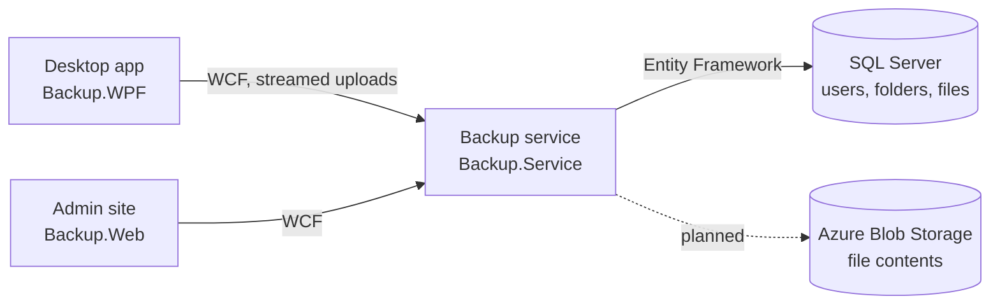

  

# Aperture Drive

> [!NOTE]
> **Archived.** A side project from 2013 that was never finished and isn't maintained. This README was written in November 2026 to record what it was meant to be. The code is left as it was, for posterity.

Aperture Drive was going to be a personal backup drive for Windows, in the spirit of Dropbox and SkyDrive, with Azure behind it. You'd sign in to a desktop app and pick the folders you cared about. It would then watch those folders and copy every new or changed file up to Azure Blob Storage, showing each file's sync state as it went. A small admin website would manage the users.

## How it fits together

| Project | What it does |
| --- | --- |
| `Backup.WPF` | The desktop app. A borderless WPF window (MVVM Light) with a sign-in panel, an "add folder" button, a tree of tracked folders and a tile for each file showing its sync state. Each tracked folder gets a `FileSystemWatcher`. Changes are debounced for two seconds, then the folder is rescanned and anything new is uploaded. Each PC is identified by its machine name, so one user could back up several. |
| `Backup.Service` | A WCF service with the backend operations: sign in, list and add a machine's tracked folders, stream a file upload, and the admin calls (list users, create a user, list roles). |
| `Backup.Azure` | Packages the service as an Azure Cloud Service: one small web role serving HTTPS on port 443. |
| `Backup.Web` | "Aperture Drive Admin", an ASP.NET MVC 4 and Bootstrap 3 site with its own membership and role providers, where administrators list and create users. |
| `Backup.DataAccess` | The database-first Entity Framework model (`ApertureBackupModel.edmx`): users and roles, an account per machine with a data quota, tracked folders, backed-up files with a state, and a user log. |
| `Backup.Domain` | The DTOs shared by the service, the desktop app and the admin site. |

## How far it got

Working, more or less:

- Signing in to the desktop app and the admin site.
- Adding folders, scanning them into the tree and watching them for changes.
- Streaming each new file to the service and recording it in the database.
- Listing and creating users in the admin site.

Never finished:

- **The actual backing up.** The service has a `WriteToAzure` method, but the call to it is commented out. Each upload was read into memory, recorded in the database and then thrown away, so no file ever reached Azure.
- **The rest of the features:** restoring files ([#10](https://github.com/cillierscharl/azure-backup-drive-dotnet/issues/10)), coping with a lost connection ([#13](https://github.com/cillierscharl/azure-backup-drive-dotnet/issues/13)), the password reset page ([#3](https://github.com/cillierscharl/azure-backup-drive-dotnet/issues/3)) and enforcing the data quotas.
- **Security basics:** passwords were stored in plain text, every new user got the password `Password`, and the desktop app tagged every upload with a hard-coded user name.

## Built with

.NET Framework 4.5 in Visual Studio 2012: WPF with MVVM Light 4, WCF, ASP.NET MVC 4 and Web API, Entity Framework (database-first), AutoMapper, Azure Cloud Services, the Azure Storage client library 2.1, SQL Server LocalDB, Bootstrap 3 and jQuery 1.9.

## Why it stays archived

The platform it was built on has moved on:

- **Azure Cloud Services (classic)**, which hosted the service, was retired in August 2024.
- **WCF** services aren't part of modern .NET. CoreWCF is the community port.
- **`WindowsAzure.Storage`** was replaced by `Azure.Storage.Blobs`.
- **.NET Framework 4.5** has been out of support since 2016.

And OneDrive, which now comes with Windows, does what this set out to do.

## History

- **2013:** built as a side project. The repo was created in September.
- **August 2016:** the code was committed here as an archive.
- **2021–2022:** two Dependabot security bumps were merged.
- **November 2026:** this README.
